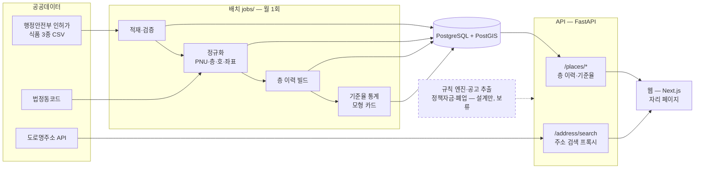

# 가게내비 (가칭)

[](https://github.com/leejunyoung0610/gage-navi/actions/workflows/ci.yml?query=branch%3Amain)

소상공인이 **자리 계약 · 정책자금 · 폐업**을 결정할 때, 공공데이터와 검증 가능한 규칙으로 돕는 웹 서비스입니다.

**현재 상태: 개발 중, 서비스는 공개하지 않았습니다.** 개발 중인 것은 **자리 이력** 하나입니다 — 데이터 파이프라인과 API를 만들었고 웹 화면을 만들고 있습니다. 정책자금·폐업 지원 모듈은 설계 문서만 있고 **보류**했습니다. 폐업 지원은 공식 창구(희망리턴패키지)와 겹치고, 건물·층 단위의 과거 가게 이력을 보여 주는 서비스는 확인한 범위에서 찾지 못해 자리 이력을 깊게 만들기로 했습니다([ADR-030](docs/02-adr.md)). 서비스 공개는 데이터·법적 기준을 정해 둔 공개 게이트([docs/50 §7](docs/50-quality.md))를 통과한 뒤에 합니다. 저장소를 먼저 공개한 이유는 [ADR-029](docs/02-adr.md)에 적었습니다.

## 문제

상가를 계약하기 전에는 **그 자리에 전에 어떤 가게가 있었고 얼마나 버텼는지** 알기 어렵습니다. 상권 분석과 지원사업 검색 서비스는 이미 있지만, **계약하려는 특정 점포 단위의 이력**은 비어 있습니다([docs/00 §2](docs/00-product.md)).

가게내비는 행정안전부 인허가 데이터를 **건물(필지)과 층 단위로 다시 묶어서**, 그 층에 있었던 가게들의 개업·폐업 기록을 보여 줍니다. 또 과거 폐업 횟수가 비슷했던 다른 자리들이 실제로 3년 안에 얼마나 폐업했는지(기준율)를 신뢰구간과 함께 보여 줍니다.

## 핵심 숫자

| 항목 | 값 | 출처 |
|---|---|---|
| 처리한 인허가 기록 | **704,116건** (서울 식품 3종: 일반음식점·휴게음식점·제과점영업) | [reports/pnu_failures.md](reports/pnu_failures.md) |
| 지번주소 → 필지번호(PNU) 변환 실패율 | **0.1062%** (748 / 704,116, 기준 0.5% 미만) | [reports/pnu_failures.md](reports/pnu_failures.md) |
| 주소 검색 일치율 | **판정용 95.85%** (1,917 / 2,000, Wilson 95% 신뢰구간 94.88% ~ 96.64%). 결과를 보기 전에 정한 기준(95% 이상)으로 통과. 참고용(대표 지번만) **94.25%** (1,885 / 2,000) — 차이 32건(1.60%)은 건물 하나가 여러 필지라 관련지번으로만 일치한 건이다. 판정용 정의("여러 필지면 그중 하나가 같으면 일치")는 측정 전에 정했다: [사전 등록 커밋과 결과 커밋의 시각](reports/search_match.md#사전-등록-커밋과-결과-커밋의-시각), [ADR-028 정정(2026-10-13, 결과를 보기 전)](docs/02-adr.md#adr-028-검색-일치율-측정의-호출-절차-측정-전-결정) | [reports/search_match.md](reports/search_match.md) |
| 테스트 | API 850개(DB 통합 테스트 109개 포함), 웹 2개 — 2026-10-14, PR #29 머지 시점의 `main` 기준, `pytest --collect-only`로 셈 | [docs/50](docs/50-quality.md) |

## 주요 판단 5가지

**1. 예측 점수 대신 사실과 기준율** — [ADR-005](docs/02-adr.md), [analysis/README.md](analysis/README.md)
설계 전 검증(W0)에서 같은 층의 과거 폐업 이력은 통계적으로 유의했습니다(과거 폐업 1회당 OR 1.075). 하지만 개별 가게 예측력은 AUC 0.6088 → 0.6109(+0.0021)로 거의 늘지 않았습니다. 그래서 "위험 점수"는 만들지 않고, 비슷한 자리들의 실제 3년 내 폐업률만 표본 수·신뢰구간과 함께 보여 줍니다.

**2. 결과를 보기 전에 기준을 커밋하기 (사전 등록)** — [ADR-028](docs/02-adr.md), [docs/50 §7](docs/50-quality.md), [reports/search_match.md](reports/search_match.md)
검색 일치율은 정의·표본(2,000건, seed 고정)·판정 구간·호출 절차를 측정 전에 커밋했습니다. 첫 측정은 컴퓨터가 잠들어 통신 오류가 쌓였고, 결과를 아무도 보지 않은 상태에서 무효로 처리했습니다. 이후 같은 표본으로 처음부터 다시 쟀습니다. 기준을 바꾼 기록과 그 시점(결과를 보기 전인지)은 ADR에 남겼습니다.

**3. 층 규모별 재분석과 미래 정보 배제** — [reports/base_rates.md](reports/base_rates.md), [docs/10 §7.2·§7.3](docs/10-module-location.md)
층 규모(동시에 영업한 최대 점포 수)는 **각 가게의 개업일까지의 이력만으로** 셉니다. 규모마다 판정 기준을 다시 적용했더니 대형 층(10곳 이상)에서는 기준이 깨졌습니다(1회당 OR 1.013, 95% 0.968 ~ 1.061). 그래서 대형 층에서는 기준율 카드를 보여 주지 않습니다. 비교로 전체 이력(개업일 뒤의 정보 포함)으로 세면 대형도 통과로 바뀝니다(OR 1.072). 미래 정보가 판정을 뒤집는다는 것을 확인하고, 이 값은 판정에 쓰지 않았습니다.

**4. 재현 테스트로 원 분석의 버그 발견** — [analysis/README.md §4 정정·§6.2](analysis/README.md), [docs/50 §3](docs/50-quality.md)
서비스 코드가 W0 분석을 그대로 재현하는지 테스트했더니 코호트가 418건 달랐습니다. 허용 오차를 늘리지 않고 원인을 찾았습니다. 원 분석 스크립트가 천 단위 쉼표가 든 면적 880건(1,000㎡ 이상 점포)을 빠뜨린 것이었습니다. 스크립트의 면적 읽기만 고쳐 기대값을 다시 만들고, 테스트를 돌리기 전에 커밋했습니다. 결론(OR 1.075, 예측력 증가 매우 작음)은 바뀌지 않았습니다.

**5. 키와 개인정보는 사람의 주의가 아니라 구조로 막기** — [ADR-014](docs/02-adr.md), [ADR-001](docs/02-adr.md), [ADR-029](docs/02-adr.md), [docs/60](docs/60-legal-compliance.md)
- 원천 데이터의 전화번호 열은 원본 적재 테이블에만 있고, 정규화 테이블·API 응답으로 옮기지 않습니다(테스트 `test_place_response_no_phone`).
- 사업장 프로필(매출·신용 구간 등)은 서버에 저장하지 않고 브라우저에만 둡니다.
- LLM SDK는 규칙 추출 패키지에서만 import할 수 있게 import-linter로 막습니다(판단은 결정론적 코드로).
- `.env`와 원본 데이터는 커밋하지 않고(`.gitignore`), CI의 gitleaks가 PR·push마다 전체 기록을 검사합니다.

## 아키텍처



전체 구성(보류한 정책자금·폐업 모듈 포함)과 모듈 경계는 [docs/01](docs/01-architecture.md)에 있습니다.

**기술 스택**
- 백엔드: Python 3.12, FastAPI, Pydantic v2, SQLAlchemy 2(async), Alembic, uv
- 데이터: PostgreSQL 16 + PostGIS 3.4, pandas, numpy, pyproj, statsmodels
- 웹: Next.js 15, React 19, TypeScript(strict), Tailwind CSS, pnpm
- 품질: ruff, mypy(`location`·`rules`는 strict), import-linter(모듈 경계), pytest, Hypothesis, Vitest, Playwright
- CI: GitHub Actions(린트·타입·단위·DB 통합 테스트, gitleaks)
- 배포 계획: 웹 Vercel, API·DB는 단일 VM(Docker Compose + Caddy)

## 개발 방식

AI 코딩 에이전트(Claude Code)와 **티켓 단위**로 작업합니다. 사람은 범위 결정, 판단, 검증, 머지를 맡습니다.

| 누가 | 한 일 |
|---|---|
| 사람 | 층 파서 정답 라벨 **40건**(40건 모두), 가설, 판정 기준 결정(사전 등록 기준·게이트 구간), 티켓별 머지 판단 |
| AI (Claude) | 구현 대부분(코드·테스트·문서 초안), 호수 파서 정답 라벨 **17건**(20건 중) |

정답 라벨의 출처는 [docs/50 §1](docs/50-quality.md)에 건수로 적었습니다. 호수 라벨 20건 중 17건은 사람이 쓴 것이 아닙니다.

- 작업은 [docs/80-tasks.md](docs/80-tasks.md)의 티켓 하나씩 진행합니다. 티켓마다 수용 기준이 있고, 가능한 것은 테스트로 옮깁니다. 한 세션에서 한 티켓만 다룹니다.
- 에이전트 규칙은 [AGENTS.md](AGENTS.md)와 [CLAUDE.md](CLAUDE.md)에 있습니다.
  - 숫자·URL을 지어내지 않습니다.
  - 모르면 UNKNOWN으로 둡니다.
  - 문서가 서로 충돌하면 멈추고 사람에게 묻습니다.
  - 사람만 할 수 있는 일(🧑: 원문 확인, 검수 판단 등)은 대신하지 않습니다.
- 사람이 내린 결정은 구현 전에 문서에 먼저 적고, 날짜와 함께 남깁니다. 설계 결정과 그 이유, 나중에 고친 내용(정정·개정)은 [ADR](docs/02-adr.md)에 있습니다.
- 커밋은 티켓 단위입니다. PR은 CI를 통과한 뒤 사람이 확인하고 rebase로 머지합니다. 공개 게이트 판정은 작업한 세션이 아닌 독립 에이전트가 점검합니다.

## 문서 지도

| 문서 | 내용 |
|---|---|
| [docs/00-product](docs/00-product.md) | 목표, 사용자, 범위, 하지 않는 것, 성공 기준 |
| [docs/01-architecture](docs/01-architecture.md) | 시스템 구성, 기술 스택, 저장소 구조, 보안 |
| [docs/02-adr](docs/02-adr.md) | 설계 결정 기록(ADR-001 ~ 030)과 의존성 기록 |
| [docs/03-data-sources](docs/03-data-sources.md) | 외부 데이터·API, 수집 방식, 배치 일정, 확인할 항목 |
| [docs/04-data-model](docs/04-data-model.md) | DB 스키마 (마이그레이션의 기준) |
| [docs/10-module-location](docs/10-module-location.md) | 자리 이력: 주소 정규화, 층·호 파싱, 이력, 기준율 통계 |
| [docs/20-rule-engine](docs/20-rule-engine.md) | 공통 규칙 엔진: DSL, 3치 판정, 최적화, 타임라인, 설명 (보류) |
| [docs/21-module-funding](docs/21-module-funding.md) | 정책자금 모듈 (보류) |
| [docs/22-module-closure](docs/22-module-closure.md) | 폐업 지원 모듈 (보류) |
| [docs/30-api](docs/30-api.md) | REST API 명세 |
| [docs/40-frontend](docs/40-frontend.md) | 화면 구조, 화면별 명세, 문구 규칙·금지 표현 |
| [docs/50-quality](docs/50-quality.md) | 테스트·데이터 검증, 사전 등록 기준, 공개 게이트, CI |
| [docs/60-legal-compliance](docs/60-legal-compliance.md) | 법적 가드레일(금지 사항), 개인정보 처리 |
| [docs/70-roadmap](docs/70-roadmap.md) | 작업 순서, 게이트 조건, 축소 규칙 |
| [docs/80-tasks](docs/80-tasks.md) | 작업 티켓과 수용 기준, 제안 티켓 |
| [docs/90-glossary](docs/90-glossary.md) | 용어집 (코드 식별자 대응) |
| [analysis/](analysis/README.md) | 설계 전 데이터 검증(W0) 결과와 재현 스크립트 |
| [reports/](reports/) | 배치 잡이 만든 측정 리포트 (손으로 고치지 않음) |

**🔎 표시**: 공고·법령·공식 문서의 **원문으로 아직 확인하지 않은 값**이라는 뜻입니다. 확인 전에는 코드·화면에 쓰지 않고, 확인하면 표시를 지웁니다(ADR-029, AGENTS.md §2).

## 로컬 실행

필요한 것: uv, pnpm, Node 20+, Docker.

```
cp .env.example .env                  # 값 채우기 (실제 키는 커밋하지 않는다)
make setup && make check              # 의존성 설치, 린트·타입·단위 테스트
docker compose up -d db               # PostgreSQL + PostGIS
cd services/api && uv run --env-file ../../.env alembic upgrade head && cd ../..
make dev                              # API :8000, 웹 :3000
make test                             # DB 통합 테스트 포함 전체 테스트
```

인허가 원본 파일은 저장소에 없습니다. 출처와 받는 방법은 [data/README.md](data/README.md)에 있습니다.
